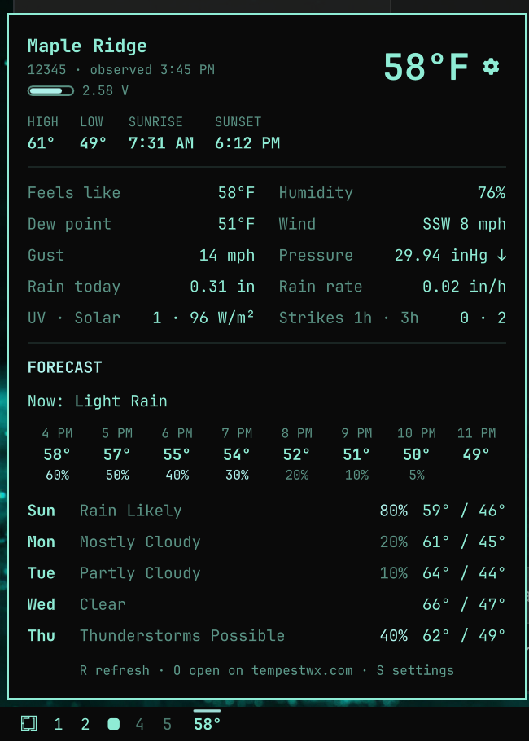

# Tempest Station for Omarchy

An [Omarchy](https://omarchy.org/) bar widget that shows the current temperature from a
[Tempest](https://tempest.earth/) (WeatherFlow) weather station, read straight from the Tempest
API, with a popout for current conditions, the sensor's battery, and the hourly and 5-day
forecast.



It shows a station you own, from your own Tempest account. What it adds over a plain weather
pill: a gauge for the sensor's battery with a low-battery warning, a dimmed reading and an
"offline since" time when the station stops reporting, and a setup form that lists your
account's stations so there's no ID to look up.

- **Bar:** the station's temperature (or feels-like), in bold. If the station stops reporting
  for more than 15 minutes (a flat battery, a lost link to the hub), the reading dims and keeps
  showing the last report until the station is back.
- **Hover:** location, feels-like, humidity, dew point, wind, when the reading was taken, and a
  warning when the sensor's battery is low.
- **Left click:** the detail panel. It shows the sensor's battery, today's forecast high and
  low, sunrise and sunset, current conditions (wind and gusts, pressure and its trend, rain
  today and rain rate, UV, solar radiation, lightning strikes), the next 8 hours and the 5-day
  forecast. Keys: `R` refreshes, `O` opens the station on tempestwx.com, `S` opens settings,
  `Esc` closes.
- **Right click:** opens the station on tempestwx.com.
- **Middle click:** refreshes the reading.

## Requirements

- Omarchy with the Quickshell bar (Omarchy 4, "Quattro").
- `curl` and `jq`, both included with Omarchy.
- A Tempest station on your Tempest account, and a personal access token for that account.

## Install

```bash
omarchy plugin add https://github.com/jeremiahjohnston/omarchy-tempest --enable
```

`--enable` asks where to put the widget on the bar. You can move it later, for example to just
after the workspace numbers:

```bash
omarchy bar move io.github.jeremiahjohnston.tempest --after omarchy.workspaces
```

## Set up your token and station

Until both are set, the bar shows **Tempest setup**. Click it to open the setup form.

1. **Access token.** Sign in at [tempestwx.com](https://tempestwx.com/) and open
   **Settings → Data Authorizations → Create Token** (the **Get a token** button goes there).
   Paste the token in and press **Enter** or **Save**.
2. **Station.** The form lists the stations your token can see, one button each. Click yours.
   With a single station, it's picked for you.

The line under the station buttons confirms the connection, or says what's wrong.

The token is saved to `~/.config/omarchy/tempest.key`, which only you can read. It is never put
in `shell.json` or on a command line. You can also set it from a terminal:

```bash
read -rsp 'Tempest token: ' t && (umask 077; printf '%s\n' "$t" > ~/.config/omarchy/tempest.key); unset t
```

If `TEMPEST_TOKEN` is set in the shell's environment, it overrides the key file.

## Battery

The panel shows the sensor's battery as a small gauge with its voltage under the station name.
The gauge is empty at 2.35 V and full at 2.65 V. It turns red, and the tooltip and panel warn
you, below 2.41 V.

For reference: on firmware 175 and newer the Tempest samples wind less often below about
2.65 V to save power. Older firmware leaves full performance below 2.455 V and turns the rain
sensor off at 2.355 V. The Tempest charges only from its solar panel, so a battery that stays
low usually means the panel isn't getting enough direct sun.

## Settings

Click the gear in the panel, or press `S`, to change these. They're stored in this widget's
entry in `~/.config/omarchy/shell.json`, so you can also set them with
`omarchy bar set io.github.jeremiahjohnston.tempest <key> <value>` (add `--json` for numbers
and true/false).

| Setting | Default | Options |
| --- | --- | --- |
| `stationId` | none | A Tempest station ID, e.g. `12345`; set by the setup form |
| `stationName` | none | Shown while loading; set by the setup form |
| `sensorDeviceId` | none | The Tempest sensor's device ID, for the battery; set by the setup form |
| `units` | `auto` | `auto` (follows your locale), `e` (°F, mph), `m` (°C, km/h), `h` (°C, mph) |
| `barValue` | `temp` | `temp` or `feels` (feels-like) |
| `decimals` | `0` | `0` or `1` |
| `showUnit` | `false` | `true` shows `64°F` in the bar instead of `64°` |
| `showForecast` | `true` | `false` hides today's summary and the forecast |
| `bold` | `true` | Bold reading in the bar; `false` for regular weight |
| `accent` | `false` | `true` draws the reading in your theme's accent color instead of the bar's text color |
| `refreshSeconds` | `300` | How often to update, `60` to `3600` |

On a vertical bar the degree sign is left off so three-digit readings fit.

## Troubleshooting

- **"Access token was rejected":** the token is wrong or was deleted. Create a new one and
  paste it into the setup form.
- **"This token can't see any stations":** the token belongs to a different Tempest account
  from the station.
- **The reading is dimmed and the panel says "offline since …":** the station hasn't reported
  for over 15 minutes. The widget shows the temperature Tempest's own station page shows
  instead, which Tempest estimates while the station is quiet (the tooltip and panel say
  "estimated"), or the last report when Tempest has no estimate. Check the sensor's battery and
  the hub's connection in the Tempest app. The widget picks the station up again automatically.
- **The widget doesn't appear after enabling it:** if `omarchy plugin enable` runs while the
  shell is still noticing a newly copied plugin folder, the shell rejects it as an unknown
  plugin. Run `omarchy plugin enable io.github.jeremiahjohnston.tempest` again.
- **A change to the plugin's files doesn't show up:** run `omarchy restart shell`.

## Remove

```bash
omarchy plugin remove io.github.jeremiahjohnston.tempest
rm -f ~/.config/omarchy/tempest.key
```

## Development

The scripts in `scripts/` talk to the [Tempest REST API](https://weatherflow.github.io/Tempest/api/),
each printing one line of JSON: `tempest-current` for the latest reading and battery,
`tempest-details` for the hourly and daily forecast, `tempest-stations` for the setup form's
station list, and `tempest-save-key` to store the token. Run the tests, which use a stubbed
`curl`, with:

```bash
for t in tests/*.sh; do "$t"; done
```

## License

[MIT](LICENSE)
